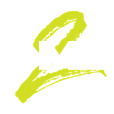

# CarX2ModLoader (C2ML)

**[Website](https://c2ml.l3g3nd.dev) · [Docs](https://c2ml.l3g3nd.dev/docs) · [Architecture](ARCHITECTURE.md) ·
[Security](SECURITY.md) · [FAQ](FAQ.md) · [Changelog](CHANGELOG.md) ·
[SDK repo](https://github.com/l3g3nd2410/C2ML-SDK)**

---

C2ML is a mod loader for **CarX Drift Racing Online 2** (Steam App ID `1826420`), built from scratch to host
mods for a native IL2CPP Unity game without the game ever shipping a managed assembly to patch.

C2ML is **closed source** - this repository is its public home: documentation, security model and FAQ for
players and mod developers. The compiled loader is downloaded from the website, never from here. See
[ARCHITECTURE.md](ARCHITECTURE.md) for how it works and [SECURITY.md](SECURITY.md) for the mod encryption model.

## What C2ML does

- Loads as a `winhttp.dll` proxy next to the game executable (no external injector, no launcher to run), so the
  game runs exactly as normal otherwise.
- Hosts a **.NET runtime** to run the mod manager, in-game UI and the mods themselves.
- Generates **IL2CPP interop assemblies** so mods (and [HarmonyX](#built-with) patches) can call into and patch
  the game like a normal managed assembly.
- Draws an in-game menu (mod list, keybinds, per-mod config, about page) with [Dear ImGui](#built-with).
- Keeps working across most routine game updates without a loader update of its own.

## Security model

Mods are distributed as **encrypted `.c2m` packages** published through
[c2ml.l3g3nd.dev](https://c2ml.l3g3nd.dev); the loader refuses plain, unencrypted DLLs by default, with a narrow
admin-curated whitelist for a few well-known BepInEx-style plugins (e.g. ReShade). See
[SECURITY.md](SECURITY.md) for the full model, including how developers test unpublished builds and how to
report a vulnerability.

## Project layout

C2ML is split into several components, all developed privately. None of their source is published - the only
things distributed publicly are the compiled loader (from the website) and the compiled `C2ML.API` DLL (in the
[SDK](https://github.com/l3g3nd2410/C2ML-SDK), for mod developers to build against).

| Component | Role |
|---|---|
| CarX2ModLoader | Native loader attached to the game: `winhttp.dll` proxy, .NET runtime host, IL2CPP interop, mod manager, in-game menu, server auth |
| C2ML.Bootstrapper | Native↔managed entry point |
| C2ML.API | The public API mods are written against - shipped as a compiled DLL in the [SDK](https://github.com/l3g3nd2410/C2ML-SDK), source kept private |

## Installing (players)

1. Download the loader from [c2ml.l3g3nd.dev](https://c2ml.l3g3nd.dev).
2. Drop `winhttp.dll` next to `CarX Drift Racing Online 2.exe`.
3. Launch the game - the in-game menu opens with a configurable keybind. Install mods from the
   [Mod DB](https://c2ml.l3g3nd.dev/#mods) or a direct link from a developer.

Questions about safety, updates or troubleshooting? See the [FAQ](FAQ.md).

## For mod developers

Mods are written in C# against `C2ML.API` and published through the [dev space](https://c2ml.l3g3nd.dev/dev).
Start with the [C2ML-SDK](https://github.com/l3g3nd2410/C2ML-SDK) repository - it has the compiled API, HarmonyX,
a full bilingual guide set and a reference mod that uses the whole API. See
[c2ml.l3g3nd.dev/docs](https://c2ml.l3g3nd.dev/docs) for the same guides rendered online.

## Built with

- [.NET](https://github.com/dotnet/runtime) - the managed runtime hosted by the loader
- [Dear ImGui](https://github.com/ocornut/imgui) - the in-game menu
- [HarmonyX](https://github.com/BepInEx/HarmonyX) - bundled in the SDK for mods that patch game code (not used
  by the loader itself)

## License

All rights reserved. C2ML is closed source; no code is published in this repository. No license is granted to
copy, modify, redistribute or reuse the loader without the author's explicit permission.
